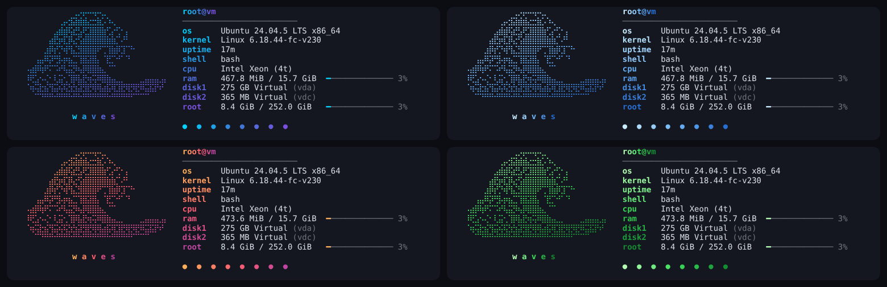

# 🌊 waves

A minimal, good-looking system fetch, in the spirit of fastfetch. One Python file, **zero dependencies**.



## What it shows
OS / distro · kernel · uptime · shell · motherboard · CPU · GPU (up to 2) · RAM (with a bar) · disks (up to 2) · `/` usage

## Install
```sh
./install.sh            # installs ~/.local/bin/waves
./install.sh --kitty    # also show waves whenever Kitty or tsunami opens
```

## Usage
```sh
waves                   # default theme
waves -c                # interactive theme picker
waves -t reef           # pick a theme
waves -l                # list themes by category
waves --themes sea      # preview a category (sea, gradient, mono, light) or all
waves --no-logo
waves --no-color
waves --json            # raw data
```

### Theme picker (`waves -c`)
| Key | Action |
|---|---|
| `←` `→` | browse themes |
| `Tab` / `Shift+Tab` | switch category: all · sea · gradient · mono · light |
| `r` | random theme |
| `Enter` | save as default (`~/.config/waves/config`) |
| `q` / `Esc` | quit |

Priority: `-t` > `WAVES_THEME` > tsunami theme > saved config > `ocean`.

### Themes (40)
- **sea** — `tsunami` `ocean` `lagoon` `reef` `deepsea` `biolume` `seafoam` `kelp` `storm` `arctic` `tropic` `riptide` `maelstrom` `nautilus` `pearl` `sandbar`
- **gradient** — `sunset` `mint` `aurora` `synthwave` `dusk` `candy` `ember` `forest` `nebula` `citrus` `vapor` `peach`
- **mono** — `mono` `snow` `graphite` `ice` `abyss` `matrix` `ruby` `rose` `lavender` `amber` `teal` `paper`
- **light** (for light terminals) — `pearl` `sandbar` `peach` `paper`

Respects `NO_COLOR`; `FORCE_COLOR=1` forces colors. Needs a truecolor terminal and a font with braille glyphs (JetBrains Mono, Nerd Fonts, DejaVu, Fira Code…). GPU names use `lspci` (`pciutils`) when available.

## Autostart in Kitty and tsunami
```sh
./install.sh --kitty            # fish, bash and zsh are detected
./install.sh --uninstall-kitty  # remove it
```
waves only shows up in interactive Kitty or tsunami windows (`$KITTY_WINDOW_ID` / `$TSUNAMI`): not in other terminals, over SSH, or in scripts. With fish, the greeting is turned off in those windows.

Block added to `~/.config/fish/config.fish`:
```fish
# >>> waves (kitty) >>>
if status is-interactive; and begin; set -q KITTY_WINDOW_ID; or set -q TSUNAMI; end; and test -x "$HOME/.local/bin/waves"
    set -g fish_greeting
    "$HOME/.local/bin/waves"
end
# <<< waves (kitty) <<<
```

## With the tsunami terminal
waves shares its 40 themes with tsunami, a companion terminal, and follows the window's theme automatically, even when you change it live with `tsunami -c`.
